# Processor-Hub — Процессные диаграммы (Mermaid)

Версия: 1.0  
Назначение: Визуализация ключевых процессов Processor-Hub

---

# 0. Архитектурно-программная диаграмма (программные слои)

Показаны программные слои Processor-Hub: от API и адаптеров до инфраструктуры. Авторизационный слой (credentials + PaymentHttpClient) — единая точка для кредов и исходящего HTTP к платёжным системам.

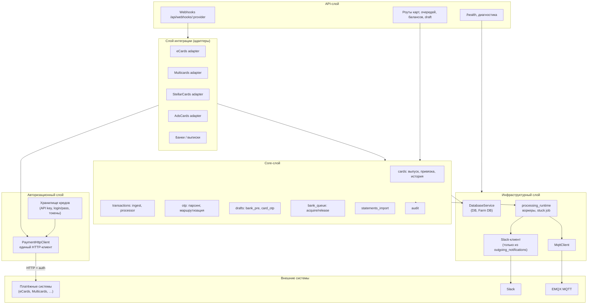

**Пояснения:**

- **API-слой:** приём webhooks, роуты для карт/очередей/балансов/draft, health.
- **Адаптеры:** маппинг форматов провайдеров во внутреннюю модель; **не** делают свой fetch — все вызовы к провайдерам через **PaymentHttpClient**.
- **Авторизационный слой:** централизованные креды и единый HTTP-клиент для платёжных систем (retry, таймауты, correlation_id).
- **Core:** бизнес-процессы (processes.md), оркестрация, идемпотентность, outbox/incoming.
- **Инфраструктура:** БД, MQTT, processing runtime, Slack (только из воркера outgoing_notifications).

---

# 1. Общая архитектура обработки событий

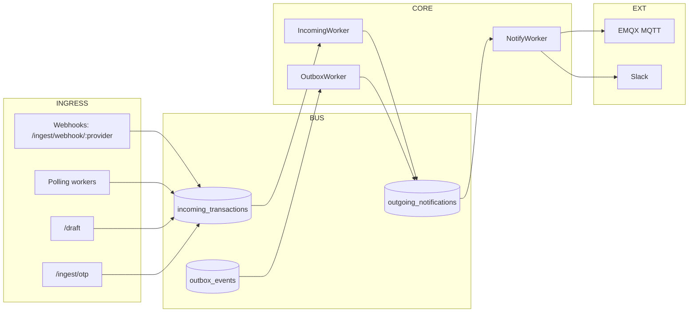

---

# 2. Карточные операции

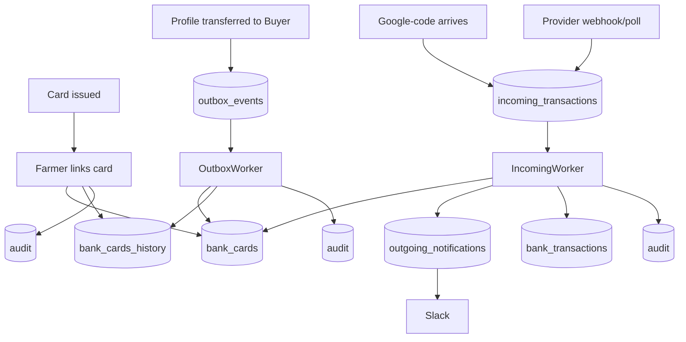

---

# 3. Банковский процесс

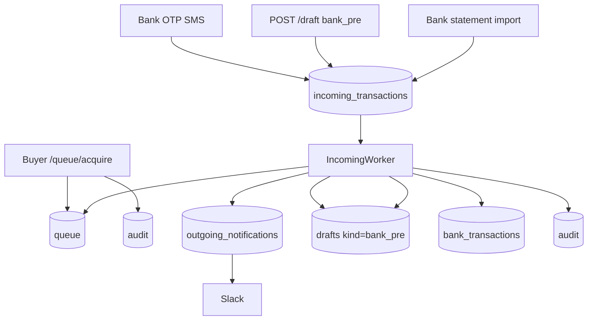

---

# 4. /draft два типа

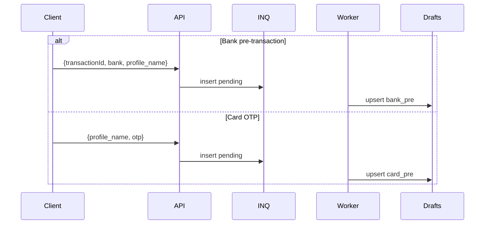

---

# 5. Импорт выписки + fallback

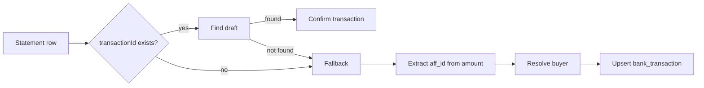

---

# 6. История владения картой

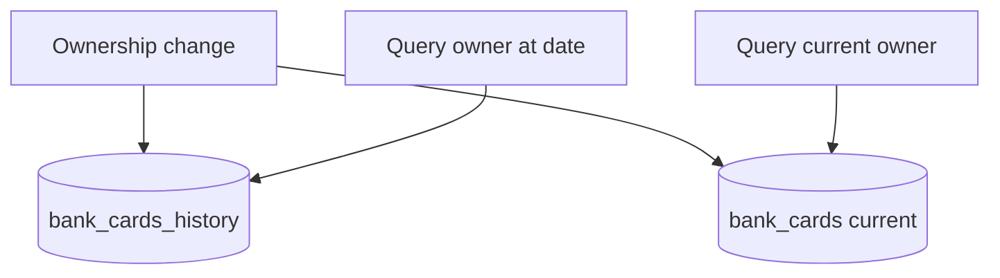

---

# 7. Processing runtime + retry/backoff (outgoing_notifications)

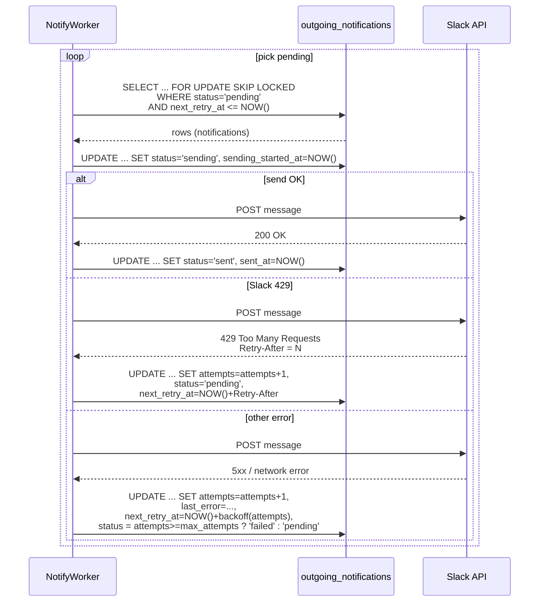

---

# 8. Очередь в банк и OTP от банка

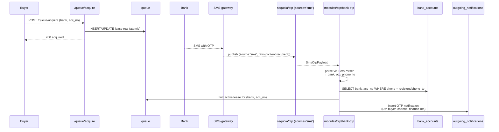

---

# 9. Hardware устройства + SmsPhones/Sms + OTP

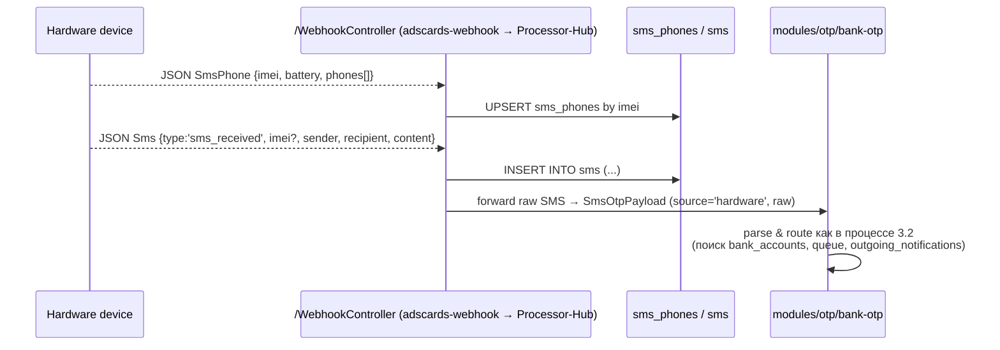

---

# 10. Импорт выписок как job + matching drafts

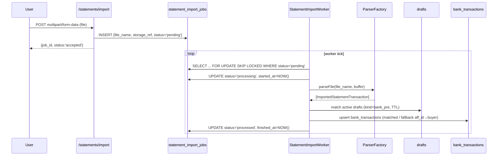

---

# 11. Unlink-dead (batch отвязка карт от мёртвых профилей, полночь)

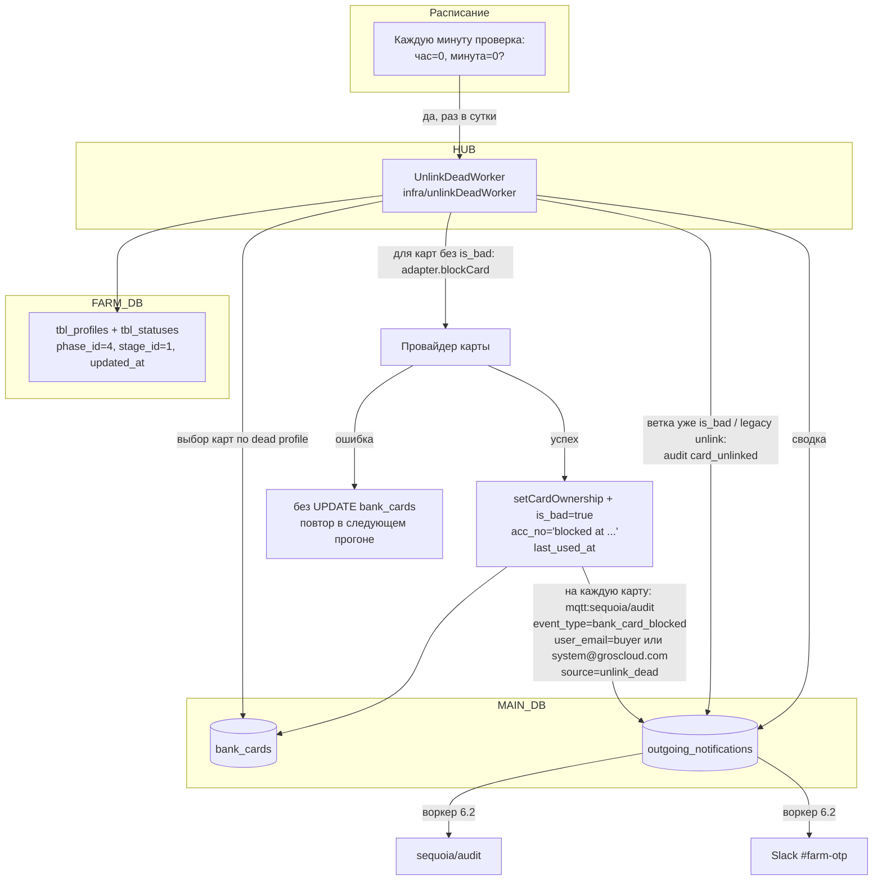

---

# 12. Управление балансами и лимитами банков

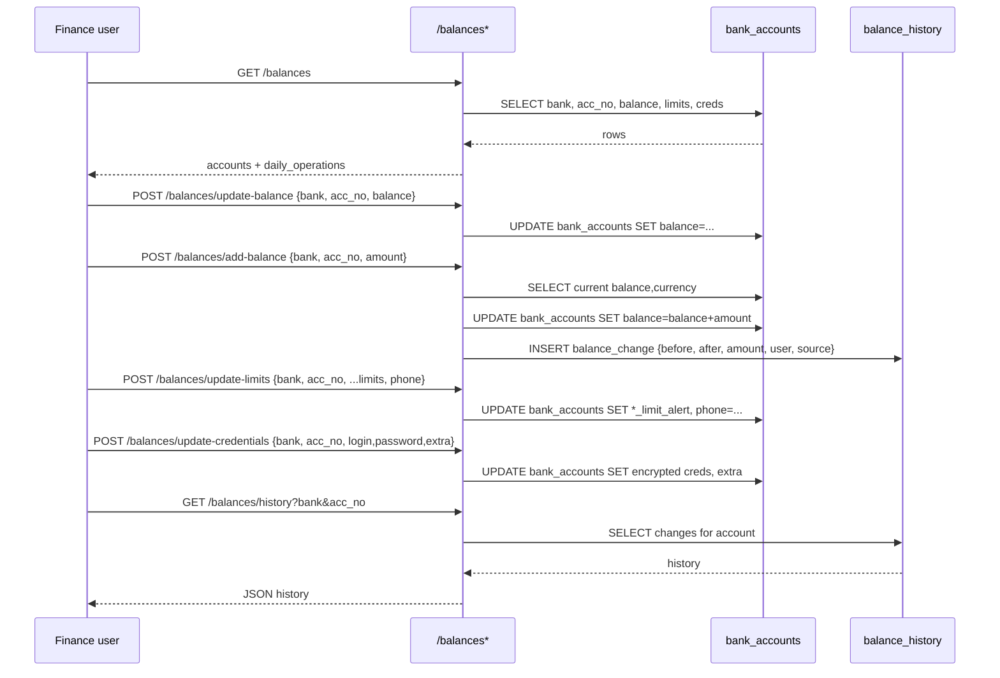

---

Документ предназначен для визуального понимания потоков.
