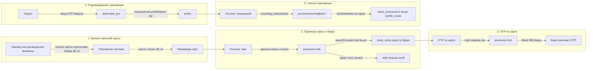
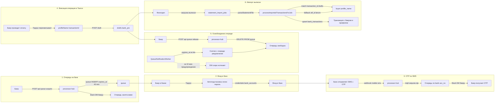
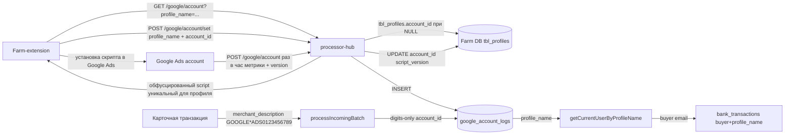

# Диаграммы потоков: карточные и банковские операции

Три сценария на основе кода processor-hub: постпэй-карты, именные карты, банковские операции.

---

## I. Карточные операции для постпэй-аккаунтов (фарм-карты)

Карта выпускается без привязки к баеру; появляется в системе «свободной», привязывается к профилю и баеру через фарм, затем может быть отвязана.

Важно: когда фармер **отвязывает карту через farm‑расширение** (`POST /api/cards/unlink`), вводится “**отлёжка**” 24 часа: карта не должна выдаваться как “свободная” в течение 24 часов после отвязки. Для этого используется поле `public.bank_cards.released_at` (timestamp) и фильтры выдачи “free” карт учитывают условие `released_at IS NULL OR released_at < NOW() - INTERVAL '24 hours'`.

```mermaid
flowchart LR
  subgraph step1["1. Выпуск карты"]
    A[Платёжная система] -->|выпуск карты| B[Карта в провайдере]
    B -->|поллинг карт| C[processor-hub]
    C -->|upsert bank_cards buyer=null| D[Карта свободная]
  end

  subgraph step2["2. Привязка к профилю"]
    E[Фарм-расширение] -->|получило карту| F[tbl_profiles карта к профилю]
    F -->|привязка| G[bank_cards profile_name]
  end

  subgraph step3["3. Передача профиля баеру"]
    H[Профиль передан баеру] -->|tbl_profile_auth_changes| I[ProfileAuthChangeWorker]
    I -->|UPDATE buyer=email removeLimits| J[Карта привязана к баеру]
  end

  subgraph step4["4. OTP по карте"]
    K[Платёжная система или SMS] -->|OTP| L[processor-hub mqtt sequoia otp]
    L -->|Slack DM баеру| M[Баер получает OTP]
  end

  subgraph step5["5. Подтверждение транзакции"]
    N[Таурус] -->|перехват OTP баером| O[draft bank_pre]
    O -->|profileName transactionId otp| P[drafts]
  end

  subgraph step6["6. Связка транзакции с баером"]
    Q[Поллинг транзакций] -->|incoming_transactions| R[processIncomingBatch]
    R -->|resolveOwner upsert| S[bank_transactions buyer profile_name]
    R -->|OTP из описания| M
  end

  subgraph step7["7. Профиль умер — блокировка у ПС и отвязка (MR 29)"]
    T[UnlinkDeadWorker] -->|phase_id=4 stage_id=1| U[Мёртвые профили]
    U -->|blockCard у провайдера| BPS[ПС карта закрыта freeze]
    BPS -->|успех| V[setCardOwnership is_bad acc_no blocked at]
    BPS -->|ошибка ПС| Rskip[Без UPDATE bank_cards повтор в следующем прогоне]
    T -->|аудит bank_card_blocked или card_unlinked Slack| W[channel farm-otp]
  end

  D --> E
  G --> H
  J --> K
  P --> Q
  S --> T
```

**Соответствие коду:**

| Шаг | Компонент |
|-----|-----------|
| 1 | Поллинг карт (adapters ecards/adscards/…), `cards/service.upsertProviderCard` → `bank_cards` без buyer |
| 2 | Фарм-расширение (внешнее) + синхронизация профиля/карты |
| 3 | `profileAuthChangeWorker`: очередь `tbl_profile_auth_changes` → `bank_cards.buyer`, `removeLimits`, аудит |
| 4 | OTP: адаптеры (ecards/otp, mobileSms) → `outgoing_notifications` (channel mqtt:sequoia/otp) → воркер вызывает OTP handler напрямую → Slack DM |
| 5 | `drafts.createBankPreDraftFromTaurus`: `/draft` → `drafts` (bank_pre, transaction_id, profile_name, otp) |
| 6 | `transactions.processIncomingBatch`: нормализация, resolveOwner, upsert `bank_transactions`, при наличии OTP в описании — DM + аудит |
| 7 | `unlinkDeadWorker`: мёртвые профили (phase_id=4, stage_id=1) → для карт без `is_bad`: **сначала** `adapter.blockCard`, затем отвязка и `is_bad` + `acc_no`; при ошибке ПС строка не меняется до следующего запуска. Аудит: `bank_card_blocked` при успехе. Подробно: [mr29_unlink_dead_block.md](./mr29_unlink_dead_block.md) |
| 8 | **`cardBlockQueueWorker`**: очередь **`card_block_queue`** (постановка через **`POST /api/card-block/block-batch`**) → блокировка у ПС через **`blockCardByCardNumber`**; если карта **уже** помечена заблокированной хабом (`is_bad` + `acc_no` `blocked at …`) — **без ПС**, только **`error`** в очереди. Синхронный **`POST /api/card-block/block`** очередь не использует. Подробно: § I.b ниже |
| 9 | **eCards + `buyer_email`:** очередь **`ecards_buyer_card_issue_queue`** и поллинг с группами eCards — § **I.d** |
| 10 | **Taurus (карты по `profile_name`):** **`GET /taurus/buyer-cards`**, **`POST /taurus/card-credentials`** — § **I.e** |

---

## I.c Multicards: группа баера и поле `acc_no`

Сценарий **только для банка `multicards`**.

**Выпуск (`POST /api/cards/create/multicards`):**

- Тело может содержать опциональное **`buyer_email`**. Если оно **не пустое**, хаб ищет в **`binom`** строку с этим баером, берёт **`aff_id`**, у Multicards получает список групп карт (`GET /v1/card/group/list`), ищет группу с **`name`**, совпадающим с **`aff_id`**, либо создаёт группу (`POST /v1/card/group/create` с **`name: "<aff_id>"`**). В запрос **`POST /v1/card/batchIssue`** добавляется **`cardGroupId`**. Без **`buyer_email`** поведение как раньше (без привязки к группе в теле batch).
- Если **`buyer_email` задан**, но в **`binom`** нет соответствующей строки — выпуск **не выполняется** (ошибка с понятным текстом).

**Поллинг карт (`GET /v1/card/list`):**

- Из объекта карты **`cardGroup.name`** (при необходимости **`cardGroupName`**) парсится числовой **`aff_id`** (имя группы при создании — строка с `aff_id`).
- По **`aff_id`** читается строка **`binom`** (**`buyer`**, **`username`**). В **`bank_cards.buyer`** попадает email баера (с прежними правилами отсечения «not found»). В **`bank_cards.acc_no`** записывается **`binom.username / binom.aff_id`**; если **`username`** пустой — только **`aff_id`**. Если из ответа Multicards **нельзя** извлечь **`aff_id`** из имени группы, **`acc_no`** остаётся **`FEBRUARY`** (как до доработки).

Код: `src/modules/transactions/adapters/multicards/create.ts`, `multicards/cards.ts`, `src/modules/binom/index.ts`.

### Adscards: поллинг карт (`POST /teams/cards_list` + `/cards/groups`)

- Поле **`card.group`** в элементе списка карт — это **внутренний id группы в Ads** (тот же **`id`**, что в ответе **`POST /cards/groups`**). По нему находится запись группы и читается **`name`**.
- **`aff_id` для Binom** извлекается **только из текста `name`**: суффикс **`… / <цифры>`** (как при выпуске: `binom.username / binom.aff_id`) или **имя целиком из одних цифр** (если группу так назвали). **Не использовать** **`card.group`** как **`aff_id`**: числовой id группы в API Ads **не совпадает** с **`aff_id`** в Binom.
- Если из **`name`** **`aff_id`** получить нельзя: **`getBinomByAffId`** не вызывается; **`acc_no`** = непустое **`name`** или заглушка **`FEBRUARY`**, **`buyer`** из Binom не выставляется.

Код: `src/modules/transactions/adapters/adscards/cards.ts` (`extractAffIdFromAdsGroupName`).

---

## I.d eCards: очередь привязки карт к баеру (`ecards_buyer_card_issue_queue`)

Сценарий **только для `POST /api/cards/create/ecards`** с **непустым `buyer_email`**.

**Постановка в очередь (API):**

- Вызов **не** идёт в eCards на выпуск карт (`adapter.create` не вызывается). В БД вставляется **`quantity` отдельных строк** в **`public.ecards_buyer_card_issue_queue`**: у всех один **`buyer_email`**, **`bin`**, общий **`request_batch_id`**, статус **`pending`**, опционально **`requested_by_email`** из JWT.
- Ответ: **`queued: true`**, **`queue_ids`**, **`request_batch_id`**, **`created: 0`**. Сами карты в кабинете eCards должны появиться **отдельно** (другой выпуск без `buyer_email`, ручной сценарий и т.п.) — иначе поллинг не к чему привязать.

**Поллинг карт (`ecards/cards.ts`, `GET /card`):**

- Для карты **без группы** в ответе API (нет имени у `groupsRelations`), с известным BIN (первые 6 цифр номера и **`resolveEcardsBin`**):
  - Берётся **самая ранняя** строка очереди с тем же **`bin`** и **`pending`** → **`processing`** (`claimEcardsBuyerQueueSlotForBin`).
  - По **`buyer_email`** строки ищется **`aff_id`** в **`binom`**. Нет строки → эта запись очереди → **`failed`** + **`error`**, PATCH не выполняется.
  - Имя группы в eCards: **`binom.username / binom.aff_id`** (как `formatMulticardsAccNoFromBinom`; без username — только **`aff_id`**).
  - **`GET .../user/card-group`** (пагинация) → поиск группы по **`name`** → при отсутствии **`POST .../user/card-group`** (`cardGroupThemeId`, по умолчанию из **`ECARDS_CARD_GROUP_THEME_ID`**).
  - **`PATCH .../user/card/{id}`** с **`cardGroupsIds`**.
  - Успех → строка очереди **`completed`**. Ошибка ПС → **`failed`** + **`error`** (только у этой строки).
- В **`note`** для `bank_cards` дописывается имя группы; **`buyer`** подставляется из binom по разобранному **`aff_id`**.

**Ограничения:** связь «строка очереди ↔ карта» — по порядку **FIFO** строк на BIN и появлению **безгрупповых** карт с этим BIN; строка в **`processing`** при падении процесса до `complete`/`fail` может зависнуть до отдельной обработки.

Миграция: `migrations/20260430_ecards_buyer_card_issue_queue.sql`. Код: `src/api/routes/cards.ts`, `src/modules/cards/ecardsBuyerCardIssueQueue.ts`, `src/modules/transactions/adapters/ecards/cards.ts`, `ecardsCardGroupAssign.ts`, `ecards/create.ts` (`getEcardsAccessToken`, `getEcardsAccountBaseUrl`, `resolveEcardsBin`).

---

## I.e Taurus: список карт баера и креды (server-to-server)

Интеграция **без JWT OpenID**: у Taurus в контексте есть только **`profile_name`**. Эндпоинты в **`src/api/routes/taurus.ts`**.

**Авторизация:** заголовок **`api-key`** = **`QUEUE_API_KEY`** (тот же секрет, что у **`POST /api/card-block/block`** и queue API). Heartbeat **`POST /taurus/heartbeat`** по-прежнему без этого ключа (см. dev simulation spec §12).

**Разрешение «баера профиля»:** Farm DB — **`farm_ext.tbl_profiles.name`** → **`auth_id`** → **`tbl_users.email`**. Функция **`resolveBuyerEmailByProfileName`** (`src/infra/farmDb.ts`) смотрит только **`tbl_profiles.auth_id`**, **не** «текущего пользователя» с учётом **`tbl_profile_access_grant.lock_exclusive`** (в отличие от **`getCurrentUserByProfileName`**). Если **`auth_id`** пуст или email не найден — для списка карт возвращается пустой массив; для кредов — **404 Not found**.

### `GET /taurus/buyer-cards?profile_name=...`

- В **основной БД:** все строки **`public.bank_cards`**, где **`LOWER(TRIM(buyer))`** совпадает с email баера, поля без **`creds`**: **`card_number`** (строка), **`bank`**, **`profile_name`**, **`is_bad`**.
- **404**, если профиля с таким именем нет в **`tbl_profiles`**.

### `POST /taurus/card-credentials`

- Тело JSON: **`profile_name`**, **`card_number`** (строка или число; в запросе используются только цифры).
- Тот же email баера; карта должна существовать в **`bank_cards`** с этим **`buyer`** и номером — иначе **404** `Not found` (без уточнения причины).
- **`creds`** расшифровываются через **`decryptCardCredentials`** (как у farm-extension). Ответ **200:** **`credentials_base64`** — **UTF-8 JSON** `{ cardNumber, cardCvv, cardExpire, bank }`, затем **Base64**; плюс **`bank`**, **`profile_name`** в JSON ответа. Ошибка расшифровки — **502** `Credentials unavailable`.
- Пишется **`bank_cards_shown`** (**`recordCardShown`**) с email баера и **`profile_name`** из запроса.

Код: `src/api/routes/taurus.ts`, `src/infra/farmDb.ts` (`resolveBuyerEmailByProfileName`), `src/infra/cardsDb.ts` (`listBankCardsByBuyerEmail`, `getBankCardForBuyerByCardNumber`).

---

## I.a Очередь на банк и флаг «телефон в сети» (`phone_online`)

Это **не** выдача карт по BIN, а статус **очереди** на банковский аккаунт для сценария OTP по SMS.

- **`GET /api/queue/status`** возвращает по каждому `(bank, acc_no)` поле **`phone_online: boolean`**.
- Если устройство **не в сети** (нет свежего `sim_last_network_at` у OTA или `updated_at` у sms_device в пределах порога), **`phone_online` = `false`** — клиент может показать, что OTP может задержаться.

Реализация: `src/infra/queuePhoneOnline.ts` (порог **2 минуты**), вызов из `src/api/routes/queue.ts`. Подробно: [card_issuance_queue_phone_online.md](./card_issuance_queue_phone_online.md).

---

## I.b Очередь массовой блокировки карт (`card_block_queue`)

Сценарий **не путать** с очередью на банковский аккаунт (`api/queue/*`, раздел I.a): здесь речь о **таблице `public.card_block_queue`** и фоновом воркере **`cardBlockQueueWorker`** (`src/infra/cardBlockQueueWorker.ts`).

### Постановка в очередь

- Клиент (например farm‑расширение) вызывает **`POST /api/card-block/block-batch`** с массивом карт; в строки очереди пишутся `card_number`, при наличии **`email`** / **`profile_name`** (из JWT и тела).
- Одиночная синхронная блокировка — **`POST /api/card-block/block`**: сразу **`blockCardByCardNumber`** (`src/modules/cardBlock/blockCard.ts`), **без** записи в `card_block_queue`.

### Обработка воркером

1. Периодический тик (интервал в коде воркера), лимиты на число карт за тик и на число карт **одного банка** за тик.
2. Выборка «ожидающих» строк: **`blocked_at IS NULL AND error IS NULL`**, join к `bank_cards` для группировки по банку.
3. Для кандидата — транзакция: **`SELECT … FROM card_block_queue … FOR UPDATE SKIP LOCKED`**; если строка уже взята другим воркером — пропуск.
4. **Идемпотентность только для очереди:** в той же транзакции читаются **`bank_cards.is_bad`** и **`bank_cards.acc_no`**. Если карта уже помечена заблокированной хабом (**`is_bad`** и **`acc_no`** с префиксом **`blocked at `**, как после успешного `blockCard` в хабе), **вызов платёжной системы не выполняется**. В колонку **`card_block_queue.error`** записывается сообщение для оператора (в т.ч. время из `acc_no` в удобочитаемом виде). Строка больше не считается «висящей» в очереди. **Аудит `bank_card_blocked` и Slack в этом ветвлении не ставятся** — повторной блокировки у провайдера не было.
5. Иначе вызывается **`blockCardByCardNumber`**: адаптер **`blockCard`**, при успехе — обновление `bank_cards` (`is_bad`, `acc_no` с меткой времени), у строки очереди **`blocked_at = NOW()`**, **`error = NULL`**, затем постановка **`bank_card_blocked`** (`source: card_block_queue_worker`) и уведомлений в Slack (как в коде воркера).
6. При ошибке блокировки у провайдера или бизнес‑ошибке (`card_not_found`, `unsupported_bank`, …) в **`error`** пишется текст из результата; **`blocked_at`** остаётся пустым.

### Связь с инцидентами

Запись в **`ops_incidents`** с **`kind: card_block_provider_error`** возможна только когда реально вызывался адаптер и он бросил исключение (см. [ops_incidents.md](./ops_incidents.md), п. 17). Ветка «уже заблокирована в хабе» **до адаптера не доходит**.

Архитектура процесса кратко: [processes.md §2.6a](../architecture/processes.md).

---

## II. Карточные операции с использованием именной карты

Карта выпускается в платёжной системе уже с «группой» (имя баера, aff_id). Мы подхватываем её поллингом и сразу привязываем к баеру.

**Соответствие коду:**

| Шаг | Компонент |
|-----|-----------|
| 1 | Внешний процесс (платёжная система, тимлид задаёт группу/aff_id) |
| 2 | Поллинг карт: адаптер отдаёт карту с `buyer` из провайдера → `upsertProviderCard` с buyer → `bank_cards` + аудит `card_issued` |
| 3 | OTP по карте → mqtt:sequoia/otp → Slack DM (тот же поток, что и в I.4) |
| 4 | Таурус → `/draft` → `drafts` (bank_pre) |
| 5 | `processIncomingBatch`: resolveOwner (адаптер / bank_cards) → upsert `bank_transactions` с buyer и profile_name |

---

## III. Банковские операции (очередь на банк, Taurus, выписка)

Баер занимает очередь на банковский аккаунт, заходит в банк (логин/пароль из системы), проводит операцию; OTP по SMS приходит в processor-hub и уходит баеру в DM; Taurus фиксирует draft; очередь снимается вручную или по таймауту; выписка импортируется и связывается с баером/профилем по transaction id и draft/aff_id.

**Соответствие коду:**

| Шаг | Компонент |
|-----|-----------|
| 1 | `api/routes/queue.ts`: POST `/api/queue/acquire` → `queueDb.acquireQueue` (expires_at + 40 мин), `enqueueQueueSlackMessage` → Slack DM |
| 2 | Внешнее: Таурус + credentials из `bank_accounts` (логин/пароль), отдаются через API/расширение |
| 3 | `api/routes/mobileSms.ts`: webhook SMS → `outgoing_notifications` mqtt:sequoia/otp; `mqtt/sequoia/otp`: по (bank, acc_no) ищется queue email → Slack DM |
| 4 | `modules/drafts`: POST `/draft` → `createBankPreDraftFromTaurus` → `drafts` (bank_pre, transaction_id, profile_name, otp) |
| 5 | Ручное: POST `/api/queue/release` → `queueDb.releaseQueue`. Авто: `queueNotificationWorker` — по expires_at снимает с очереди, ставит уведомления (за 10 мин — предупреждение, по истечении — снятие + DM) |
| 6 | `statementsImport`: загрузка выписки → `processImportedTransactionsForJob` → `enrichImportedTransaction` (сначала draft по bank + transaction_id, иначе aff_id → binom) → upsert `bank_transactions` с buyer, profile_name; аудит bank_transaction_confirmed / bank_transaction_fallback_matched / bank_transaction_imported |

---

## Замечания

- **Поллинг карт** — адаптеры в `modules/transactions/adapters` (ecards, adscards, …); результат попадает в `bank_cards` через `cards/service.upsertProviderCard`.
- **Передача профиля** — очередь `tbl_profile_auth_changes` (Farm DB) обрабатывается `profileAuthChangeWorker`; обновляет `bank_cards.buyer`, снимает лимиты (removeLimits), пишет аудит.
- **OTP** — источники (карта, SMS) пишут в `outgoing_notifications` (channel mqtt:sequoia/otp); воркер вызывает OTP-обработчик напрямую (без MQTT) и создаёт slack:dm, slack:#finance-otp, mqtt:sequoia/audit.
- **Очередь на банк** — 40 минут (задаётся в `queueDb`); предупреждение за 10 минут и автоснятие по истечении — в `queueNotificationWorker`.
- **Google Ads script и farm-extension** — два вызова со стороны расширения: (1) `GET /google/account?profile_name=...` — текст обфусцированного скрипта, **сгенерированного под конкретный профиль**; (2) `POST /google/account/set` — передача `profile_name` и Google Ads `account_id` (`XXX-XXX-XXXX`) для сохранения в **`tbl_profiles.account_id`** при первичной привязке (если поле ещё пустое). После установки в Google Ads скрипт работает **раз в час**, шлёт метрики и **`version`** (версия скрипта).
- **Логи и профиль** — `POST /google/account` (вызов из Google Ads, не из расширения) пишет строку в `public.google_account_logs` и обновляет Farm DB: **`tbl_profiles.account_id`** и **`tbl_profiles.script_version`**. **Скрипт считается установленным, если задано `tbl_profiles.script_version`** (значение приходит с отчётами); `account_id` на профиле фиксируется и через расширение, и через часовые POST.

---

## Приоритет поиска баера по карточной транзакции

1. Если в описании платежа есть `GOOGLE*ADS0123456789` (10 подряд идущих цифр), это приоритетный путь:
   - из описания берём 10 цифр Google Ads ID;
   - сначала ищем `profile_name` в `public.google_account_logs` по `account_id`, нормализованному до цифр (`0123456789`);
   - если не нашли, ищем в `finance0_ext.funds_from_account` тем же образом;
   - в обеих таблицах `account_id` может храниться как `012-345-6789`, поэтому сравнение делаем по digits-only;
   - если `profile_name` найден, владельца определяем через `getCurrentUserByProfileName()`;
   - этот путь имеет **более высокий приоритет**, чем любые определения по банковской карте.

2. Далее через адаптеры платёжных систем вытаскиваем полный номер карты (16 цифр) из транзакции и ищем:
   - `SELECT email, profile_name FROM bank_cards WHERE card_number = {card_number}`

3. Если по шагам выше не найдено, используем неявный поиск по аудиту передачи карты:
   - `event_type IN ('card_linked', 'card_unlinked')`

---

## IV. Google Ads script и быстрый резолв баера

---

## V. Агрегатор расходов в `public.spends` (eCards)

Ниже описан текущий сценарий batch-скрипта `src/bin/buildEcardsFundsCardStats.ts`, который формирует и сохраняет аналитические строки в `public.spends`.

### Структура `public.spends` (используемые поля)

- Ключ upsert: `(card_number, buyer, bank)`.
- `bank` в текущем сценарии фиксирован как `ecards`.
- Агрегаты транзакций карты:
  - `bank_transactions_total_amount_usd` — сумма списаний по формуле `SUM(amount_usd) WHERE amount < 0`
  - `bank_transactions_debit_amount_usd` — то же значение (списания)
  - `bank_transactions_refund_amount_usd`
  - `bank_transactions_count` — количество операций списания (`amount < 0`)
- Агрегаты пополнений:
  - `funds_profiles` (`text[]`)
  - `funds_amount_usd_total`
- Диагностический слепок: `payload` (`jsonb`).
- Служебные поля: `created_at`, `updated_at`.

### Алгоритм обработки (построчно)

1. Скрипт читает записи из `finance0_ext.funds_from_account`:
   - `active = true`
   - `payment_method IS NOT NULL`
   - `length(payment_method) > 0`
   - `created_at >= '2026-03-01'`
   - `ORDER BY created_at DESC`.

2. Для каждой записи выполняется полный пайплайн сразу (без отдельной фазы «собрать все карты»):
   - берется `profile_name`;
   - по `profile_name` резолвится текущий владелец через `getCurrentUserByProfileName(...)`;
   - из `payment_method` извлекается `last4` карты:
     - приоритетно из маски `• • • • 1234` / `* * * * 1234`;
     - fallback: первые 4 цифры после бренда (`Visa`/`Mastercard`);
     - последний fallback: первая подходящая 4-значная группа.

3. По `buyer + last4` ищется карта в `public.bank_cards`:
   - фильтр: `bank = 'ecards'`;
   - если найдено более одной карты, запись считается неоднозначной и пропускается;
   - если карта не найдена, запись пропускается.

4. По найденной карте считается агрегат в `public.bank_transactions`:
   - траты (spent): `SUM(amount_usd)` только по строкам `amount < 0` (это основная формула для `spends`);
   - возвраты: `SUM(amount_usd)` по строкам `amount_usd > 0`;
   - количество трат: `COUNT(*) FILTER (WHERE amount < 0)`;
   - выборка ограничена `bank = 'ecards'` и `raw->'card'->>'cardNumber' = card_number`.

5. Выполняется `INSERT ... ON CONFLICT ... DO UPDATE` в `public.spends`:
   - вставка «входящего» вклада текущей строки с `funds_profiles = [profile_name]` и `funds_amount_usd_total = row.amount_usd`;
   - при конфликте:
     - `funds_profiles` объединяются как множество (`existing ∪ incoming`);
     - `funds_amount_usd_total` увеличивается на вклад текущей строки (`existing + incoming`);
     - `bank_transactions_*` обновляются актуальным срезом по карте;
     - `payload` пересобирается из итоговых значений.

6. В конце скрипт печатает:
   - прогресс/диагностику (`START/FETCH/PROGRESS/CARD_LOOKUP/AGGREGATE/UPSERT/DONE`);
   - JSON-вывод актуального набора обработанных карт.

### Инварианты сохранения важных данных

- Имена профилей не теряются: `funds_profiles` всегда merge с дедупликацией.
- При повторных запусках накопленная сумма пополнений сохраняется инкрементально.
- Неоднозначные соответствия (`buyer + last4` → более одной карты) не записываются, чтобы не вносить ошибочные данные.
